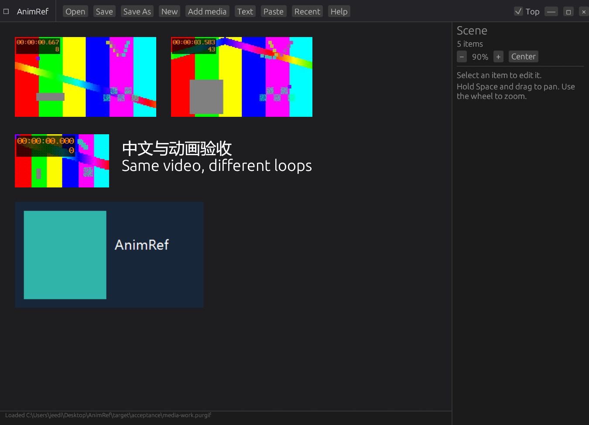

# AnimRef

AnimRef is a Windows reference board for images, animated GIFs, text, and video. It uses a native Rust/egui interface and keeps existing `.purgif` scenes readable. YouTube clips are prepared from metadata first: choose a source start and end, then explicitly download that section. The app does not download the full source before trimming.



## Run from source

Install Visual Studio 2022 Build Tools with the MSVC C++ workload and Windows 10/11 SDK, then run PowerShell from the repository:

```powershell
./scripts/setup-windows.ps1
cargo run
```

`rust-toolchain.toml` selects the rolling Rust stable channel and requests the `rustfmt` and `clippy` components; it does not pin a specific Rust release. The setup script installs the Rust components and places FFmpeg/ffprobe, yt-dlp, and Deno in the current user's AnimRef tools directory. Node.js is not required.

To build and package a release folder and zip:

```powershell
./scripts/package-windows.ps1
```

The output is `dist/AnimRef/AnimRef.exe`, with the media tools beside it under `tools/`, and `dist/AnimRef-Windows.zip`. The app also checks `%APPDATA%\AnimRef\AnimRef\data\tools` for those tools, so developers can run directly after setup.

The release targets Windows 10/11 x64 and uses the Microsoft Visual C++ x64 runtime (`VCRUNTIME140.dll`). The configured build machine already has it; another machine may need the Microsoft Visual C++ Redistributable installed before launching the zip's executable.

## Using the board

- Open, save, and create scenes from the title bar. Scenes keep their `.purgif` extension.
- Add files with **Add media**, drag files onto the board, or paste a local file, image, text, or supported media URL.
- Drag an item to move it. Drag its blue lower corner to resize while preserving its aspect ratio. Use the mouse wheel to zoom around the pointer, middle-drag or hold Space and drag to pan, and Ctrl+Space+drag to zoom. Right-drag the frameless window.
- Select a video and choose **Edit video** to focus it and adjust loop endpoints while previewing. The timeline shows the current playback position and can seek within the clip.
- Paste a YouTube URL. After metadata loads, set start/end as seconds or `HH:MM:SS` and select **Download selected section**. Downloads can be cancelled. The cached clip is tied to its source URL, source duration, and downloaded source range; saved scenes retain the mapping and loop ranges.
- Press **Ctrl+L** to open, **Ctrl+S** to save, **Ctrl+Shift+S** to save as, **Ctrl+N** for a new scene, **Ctrl+V** to paste, **Ctrl+W** to close, **Ctrl+F** to maximize/restore, **Ctrl+M** to minimize, and **Ctrl+H** for help. **Delete** removes the selected item.

## Media tools

YouTube metadata and section downloads use yt-dlp with Deno for YouTube's JavaScript challenges. FFmpeg performs section extraction and decodes video previews; ffprobe reads duration. The sidecars are downloaded from their publishers by `scripts/setup-windows.ps1`, with SHA-256 validation for yt-dlp and FFmpeg and signature verification for Deno.

## Validation

```powershell
cargo fmt --all -- --check
cargo test --locked
cargo clippy --locked --all-targets -- -D warnings
cargo build --release --locked
```

The `.github/workflows/main.yml` workflow runs these checks and packages a Windows zip on pushes and pull requests.

See [environment setup](docs/ENVIRONMENT.md) and the [acceptance record](docs/ACCEPTANCE.md) for installed versions, verification results, and test limitations. Media files and downloaded caches remain external to `.purgif` scenes.
