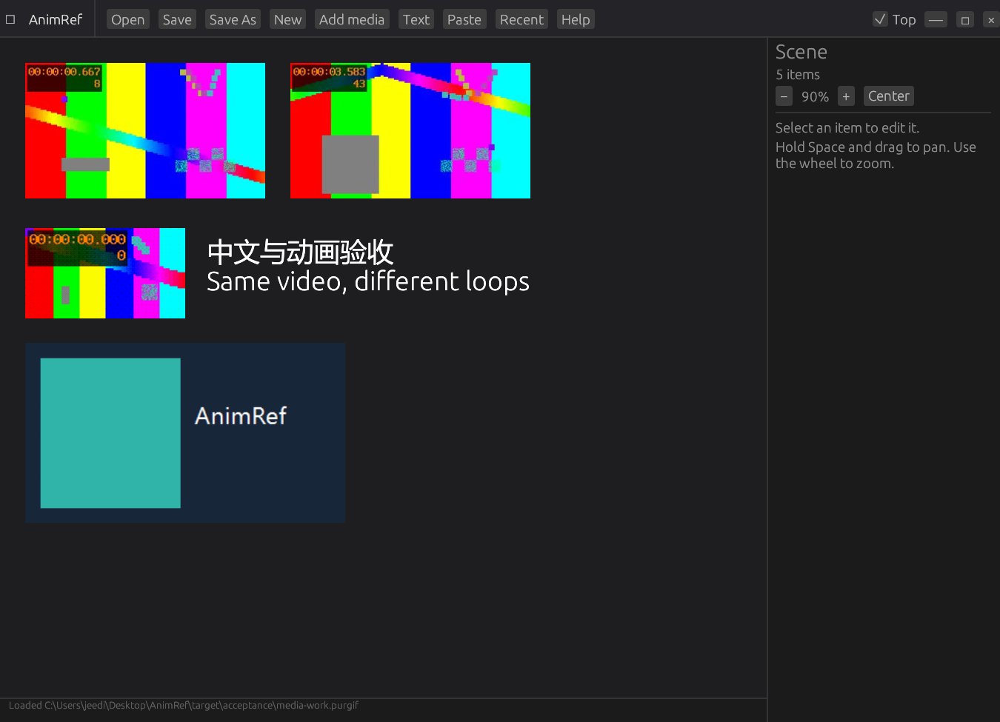

# Windows Rust migration acceptance

Historical record for migration commit `e5af418`. The later canvas/playback revision requires its own acceptance evidence; the executable hash, screenshots and test counts below describe that earlier release.

Application accepted on 2026-10-17 against the original `59a963c` baseline. Luna implemented the migration; the lead independently reviewed the source, ran the final tests and inspected actual GPU-rendered snapshots. Package verification is recorded separately below.

## Build and tests

| Check | Result |
| --- | --- |
| Rust/MSVC/SDK configuration | Installed, linker probe and complete setup script passed; versions in ENVIRONMENT.md |
| `cargo fmt --all -- --check` | Passed |
| `cargo test --locked` | 17 passed; two integration tests intentionally opt-in |
| `cargo clippy --locked --all-targets -- -D warnings` | Passed |
| Lead: `cargo test --locked -- --include-ignored --nocapture` | **19 passed, zero failures**, including live YouTube metadata/cache/decoding and real decoder timing |
| `cargo build --release --locked` | Passed; final EXE 9,889,280 bytes |
| PowerShell setup/package parsing | Passed |

The release EXE SHA-256 is `DE16FA4733C8E1B56AE945ABE7A33918A5A3E9D67CDF0CF80688CDE242097DAF`.

Regression coverage includes legacy JSON and null geometry, camera recovery from old video-edit state, source loop percentages, shortened YouTube links saved with image types, relative-path save/reload, Chinese/multiline text, atomic saving, rapid Ctrl+S events, pointer-anchored zoom and dragging at non-unit scale. Test history writes use isolated temporary storage.

The real decoder regression generates a four-second video and receives 24 frames from a one-second loop in approximately one second. It caught and repaired FFmpeg output bursting: the app now schedules frames with its own clock and a bounded two-frame queue.

## Screenshot and runtime evidence

All six cases ran the **release executable** with `--scene`, `--screenshot`, `--smoke-report`, and `--quit-after-smoke`. Each exported a real egui GPU frame and JSON report, then exited normally with code zero. The lead visually inspected the images. Raw evidence and the local harness are under `target/acceptance`; these generated files are ignored by Git.

| Case | Observed result |
| --- | --- |
| Five-item board | Two independent elements using the same MP4, different loop ranges, GIF, PNG and Chinese/multiline text; **87 decoded video frames**, no media errors |
| Legacy image types | `img`, embedded `dataURL`, `filePath`, null dimensions and text rendered; null dimensions became intrinsic 320x180; one deliberately missing file produced a recoverable placeholder |
| Legacy remote image | Extensionless HTTP URL with `filePath` type rendered at 320x180; MIME/byte decoding succeeded and status became “Remote image loaded” |
| Cached YouTube | **48 decoded frames**, two-second cached media, source range `[2,4]`, no errors |
| User's actual old scene | **Seven elements loaded: one local video and six YouTube items; 236 decoded frames, zero image/video errors**. Two previously mislabeled short links migrated to YouTube items. Uncached items wait for explicit section selection/download |
| Invalid JSON | Error shown in a functioning window; no crash or decoder process |

The user's original scene was opened read-only. Its SHA-256 remained `EBAFC97AA30FBEF68588E476F18BAB11CA22C4903D6796818A97975163D8C4FC` before and after acceptance.

Native Ctrl+S and Ctrl+W were also exercised once through the operating system. The saved synthetic scene retained scale 0.9, Chinese/newlines, positions and both independent loop ranges; resolved media paths remained absolute across reload. Normal closure and snapshot self-closure left no AnimRef FFmpeg/yt-dlp child processes.

## YouTube section preparation

The public 19-second `jNQXAC9IVRw` sample returned metadata without cookies. Initial section preparation produced a 2.000-second H.264/AAC clip for source seconds 2–4 (84,892 bytes). The final application-job integration test verified live metadata, cache reuse, duration and real FFmpeg frame decoding.

The downloader uses explicit selected-section arguments and verifies output duration before publishing the cache entry. Scene loading does not automatically download YouTube media. Original URL/duration/ranges and inactive legacy loop pairs are retained separately from clip-local playback ranges. Source segmentation/keyframes may require adjacent data; exact network-byte boundaries are not promised.

## Distribution and cleanup

Package audit: **passed**. The folder executable launched from `dist/AnimRef` with its adjacent media tools, rendered the five-item board and decoded 56 video frames without media errors, exported a GPU snapshot and exited normally. Its SHA-256 matches the tested release. The zip contains the app, all four sidecars, five license/notice files, Readme and documentation/screenshot (17 entries); decompressed executable hashes were checked against the folder copies. The final archive checksum is saved beside the zip.

Old Electron main/preload/renderer files, HTML/CSS, interact.js, npm manifests/lockfile, obsolete GIF/SVG assets and Node-specific ignore rules were removed. The Windows workflow, Readme and environment/setup/package instructions were rewritten for Rust. Original MIT licensing remains; bundled media tools have separate notices and license texts.

## Scope of verification

Windows on this machine was verified. A clean Windows VM and remote GitHub Actions execution were not tested. The EXE imports `VCRUNTIME140.dll`; the configured machine has the required Microsoft Visual C++ x64 runtime.

Per the user's request, verification emphasized GPU screenshots and serialized runtime evidence. The native capture service returned `FrameArrived timed out` / `window capture timed out`, so coordinate-based screenshot automation was not used. Clipboard formats, every window gesture and every dialog path were not exhaustively automated; their implementation was reviewed, with targeted event-level tests and the native shortcut checks above. No macOS/Linux support is claimed.
